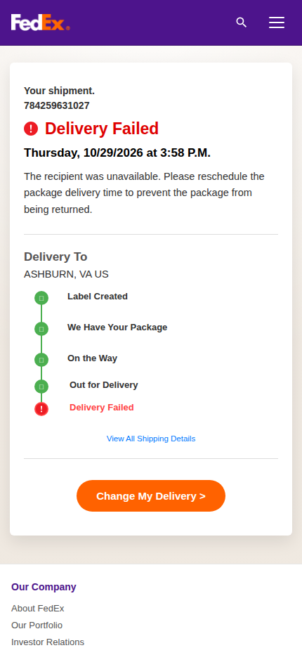
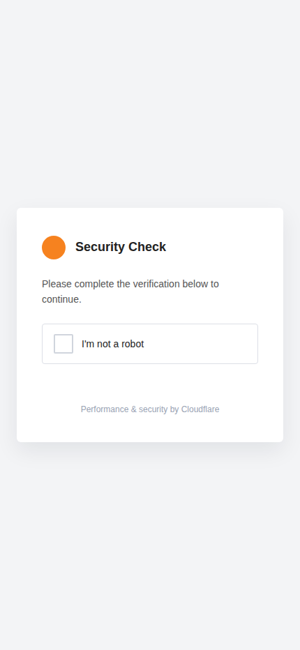

# qxvwnwx.shop — FedEx "delivery failed" phishing with a live operator

**Case:** `2026-10-qxvwnwx-shop` · **Status:** filed, name still live at last
check · **First observed:** 2026-10-29

## Summary

A smishing funnel impersonating FedEx, delivered by SMS as
`https://fedex@qxvwnwx.shop/query`. The `fedex@` is URL **userinfo**, not a
host: the real origin is `qxvwnwx.shop`, which holds a valid Let's Encrypt
certificate for exactly that name — so both the padlock and the hostname check
pass, and the leftmost thing a recipient reads on a phone is "fedex".

The page chain is a two-stage kit: a hand-written fake Cloudflare "Security
Check", then a FedEx-branded "Delivery Failed" page that collects address, card
number/CVV, cardholder name, email, phone and one-time codes. Every keystroke
is streamed to a **human operator** over a WebSocket, who can push "wrong code"
or "card declined, try another" and re-prompt the victim mid-session.

The domain was registered and put to work the same day (registration
10:01:22Z, certificate 12:32:10Z). It is part of a documented kit lineage that
public research has followed from a single lure to hundreds of hostnames.

## Timeline (UTC)

| when | event | source |
|---|---|---|
| 2026-10-28 15:14:38 | kit staged (`index.html` Last-Modified) | HTTP header |
| 2026-10-29 10:01:22 | domain registered (`qxvwnwx.shop`, Dynadot) | registrar RDAP |
| 2026-10-29 10:08:33 | registration last changed | registrar RDAP |
| 2026-10-29 12:32:10 | Let's Encrypt certificate issued (issuer `YE1`) | TLS probe |
| 2026-10-29 19:52 | first observed by us | our fetch |
| 2026-10-29 19:58 | headless renders of both stages | screenshots below |
| 2026-10-29 20:16–20:33 | reports filed (see *Disclosure*) | case log |

Registration to victim delivery: **~9 hours**.

## Infrastructure

| layer | value | evidence |
|---|---|---|
| domain | `qxvwnwx.shop` | DNS |
| A | `43.153.100.68` (only A; no AAAA, no CNAME) | DNS inventory |
| NS | `ns1.dyna-ns.net`, `ns2.dyna-ns.net` (Dynadot DNS) | DNS |
| MX / TXT | **none** — no mail service, no SPF, no DMARC | DNS |
| registrar | Dynadot LLC (IANA ID 472), handle `DO19337731-GMO` | registrar RDAP |
| registrant | privacy-shielded | registrar RDAP |
| expiry | 2027-10-29 | registrar RDAP |
| host | Tencent Cloud Singapore, APNIC `43.153.0.0/16`, netname `ACEVILLEPTELTD-SG` | APNIC RDAP |
| front proxy | Caddy (`Via: 1.1 Caddy`, HTTP/3 `alt-svc`) | response headers |
| backend | Java Spring Boot (stock error JSON, `+08:00` timestamps), internal prefix `/__theme/runtime/site/` | 403/404 bodies |
| TLS | TLS1.2 + 1.3 only; ECDSA leaf, serial `51c5cb9e2b957a9c7bda849aa24027dcb55`; chain ISRG Root X2, verified | TLS probe |
| posture | no HSTS, no CAA, DNSSEC unsigned | TLS probe |

The absence of MX/TXT matters: the name exists only to serve the web funnel,
not a business.

## Funnel

### Stage 1 — fake Cloudflare "Security Check"

Any client without the kit cookie gets a 3,910-byte page that imitates
Cloudflare's interstitial with no genuine Cloudflare artifacts (no `cf-ray`,
no `__cf_bm`, no `/cdn-cgi/` asset, no Turnstile script) — an orange dot and the
line "Performance & security by Cloudflare". The HTML is hard-coded
`<html lang="zh-CN">` on an English page.

The click performs the gate:

```
GET /__theme/runtime/site/verify?redirect=%2Fquery
302 Location: /query
Set-Cookie: theme_site_verify_us_post_fedex=1; Path=/
```

Cookie name format: `theme_site_verify_<country>_<product>_<brand>`.

### Stage 2 — FedEx-branded SPA

`/query` serves a Vue 3/Vite SPA (`/assets/index-BqyBDgCT.js`, 650 KB; CSS
31 KB). The rendered landing page is a faithful FedEx "Delivery Failed" notice:
tracking number `784259631027`, "Delivery To ASHBURN, VA US", a five-step
tracking rail ending in red "Delivery Failed", and an orange **Change My
Delivery** button.





From there the client-side router advances through `/address`, `/form` (card),
`/zz-verify` / `/app-verify` / `/custom-verify/:id` (codes and operator-chosen
prompts) and `/result`. Direct navigation to those routes returns 404 — the edge
has no SPA fallback, so the funnel only advances inside the page.

### Live operator channel

```js
TEMPLATE_CONFIG = {page:"us_post_fedex", pageTitle:"fedex", country:"us",
                   customType:"fedex", websocketPath:"/ws"}
```

The page opens `wss://qxvwnwx.shop/ws?clientSessionId=<uuid>&referrer=…` and
exchanges JSON:

| direction | message | meaning |
|---|---|---|
| page → operator | `page_type` | which stage the victim is on |
| page → operator | `input_text` (`{key,text}`) | **every keystroke**, labelled |
| page → operator | `submit_form` (`{formData:{…}}`) | the harvested record |
| operator → page | `redirect`, `verify_error`, `card_error`, `session_context` | live steering |

Console strings in the operator's language (`[WS] 已连接`, `[WS] 心跳超时，主动断开重连`)
sit under English UI copy. A plain GET on `/ws` answers
`Can "Upgrade" only to "WebSocket"`.

Fields the bundle knows how to capture: `cardNumber`, `cvv`, `expiry`,
`fullName`, `address`, `city`, `state`, `zip`, `email`, `phone`, `pin`,
`verifyCode`.

## Cloaking

| client | result |
|---|---|
| no cookie, browser-ish UA | fake Cloudflare page (200, 3,910 B) |
| cookie `theme_site_verify_us_post_fedex=1` | real SPA (200, 514 B) |
| Googlebot UA | 403 `{"timestamp":"…+08:00","status":403,"error":"Forbidden","path":"/__theme/runtime/site/query"}` |
| plain `curl` UA | same 403 body |
| deep-link to a funnel route | 404 |

The 403 leaks the backend mapping, the framework and the operator's timezone
(UTC+8). Bot and CLI user agents are refused while browsers get the lure — which
also means a `403` from a CLI request is the filter, not a takedown.

## Kit family

Structural markers match the "V2" lineage documented by Censys ARC in
*"The Package That Never Shipped"* (2026-06-12), which followed one USPS lure
hostname to 682 hostnames across seven Tencent hosts and found its UPS twin:

- `theme_site_verify_us_post_<brand>` cookies — the operator's internal theme
  name, leaked in the cookie (their UPS build used `…_us_post_ups`);
- a `/__theme/runtime/*` redirect chain in front of a Spring Boot backend
  behind Caddy, timestamps `+08:00`;
- Tencent hosting;
- **fork artifact**: this FedEx page's favicon is `/usps/images/delivery.svg`.

It is **not** the JWR/`trsb.top` kit (zero `JWR`, `cvrform`, `getSyncSettings`
markers in the bundle; transport is plain JSON WebSocket, not the JWR
encrypted envelope).

We state a lineage, not an actor. Public reporting places this family in the
Smishing Triad marketplace; nothing observed identifies a person or crew.

## Indicators

```
# network / registration
qxvwnwx.shop
https://qxvwnwx.shop/query
https://fedex@qxvwnwx.shop/query            # as delivered (userinfo)
43.153.100.68                                # A (Tencent Cloud SG)
ns1.dyna-ns.net, ns2.dyna-ns.net             # NS (Dynadot)
DO19337731-GMO                               # registrar handle

# certificate
CN=qxvwnwx.shop  issuer CN=YE1,O=Let's Encrypt,C=US
serial 51c5cb9e2b957a9c7bda849aa24027dcb55
notBefore 2026-10-29T12:32:10Z  notAfter 2027-01-27T12:32:09Z

# http
Server: Caddy            Via: 1.1 Caddy
Etag: "dmgkin9zzwia-ea"  Last-Modified: 2026-10-28 15:14:38 GMT
Cookie: theme_site_verify_us_post_fedex=1

# paths
/query                                          # landing
/__theme/runtime/site/verify?redirect=%2Fquery  # cookie gate (302)
/__theme/runtime/site/query                     # backend mapping (403 body)
/__theme/runtime/site/pass                      # Spring 404 -> namespace live
/__theme/runtime/entry/verify                   # Caddy 404 -> entry chain absent
/ws                                             # operator websocket
/assets/index-BqyBDgCT.js
/assets/index-nD4HqnNz.css
/address /form /zz-verify /app-verify /custom-verify/:id /result

# file hashes (sha256)
8e059b35e2f189e6ae11fe5d8f9d6bd04b059429e46e04ba65a3a6acb67cb9cf  index-BqyBDgCT.js
1bf0e17ecbb8a7a87d281c7cc1232820abd43fb3e41a4a790b1e33dc8a1e5349  index-nD4HqnNz.css

# UI / template markers
"Your shipment." / "Delivery Failed" / "Change My Delivery" / "Welcome | fedex"
"Performance & security by Cloudflare" (imitation; no /cdn-cgi/ assets)
TEMPLATE_CONFIG page:"us_post_fedex" customType:"fedex" websocketPath:"/ws"
```

## Google Safe Browsing status

Queried through Google's public transparency endpoint and calibrated against
controls before interpreting:

| host | tuple | reading |
|---|---|---|
| `example.com` | `["sb.ssr",1,…]` | clean |
| `wikipedia.org`, `google.com` | `…,4,…` | no data / not evaluated |
| nonexistent `*.shop` | `…,6,…,0,…` | name not found |
| `malware.testing.google.test` | `…,3,true,false,false,…` | flagged, type #1 |
| `testsafebrowsing.appspot.com` | `…,3,true,true,true,…` | flagged, types #1–3 |
| `qxvwnwx.shop` | `["sb.ssr",2,false,false,true,false,false,…]` | non-clean verdict, third type flag set |

The exact semantics of status `2` vs `3` are not documented; what the tuple
establishes is a non-clean, threat-flagged class rather than the clean/no-data
classes. A report to Safe Browsing was filed regardless — the tuple is
evidence, not a guarantee that Chrome warns.

## Cluster pivots (what failed, recorded as fact)

| pivot | result |
|---|---|
| passive-DNS reverse IP | quota-limited on the free keyless source |
| urlscan page index by IP and by domain | 0 results (name <1 day old) |
| Shodan InternetDB | `hostnames: []` |
| AlienVault OTX passive DNS | empty |
| crt.sh identity search | 0 (index lag); CertSpotter had the single issuance |
| PTR for the address | none |

No sibling apex was identified on day zero. A one-day-old name on shared
hosting has no passive-DNS footprint yet; re-pivoting later is the follow-up,
not a scan of neighbouring addresses.

## Disclosure

Filed 2026-10-29 within ~1 hour of collection, one message per desk, each with
the rendered impersonation attached:

- **registrar** (abuse desk + its own intake form) — suspend the name, preserve
  logs, and note the registrant handle;
- **registry** (.shop) — its intake returns a case ID (withheld here: it is
  keyed to the reporter identity);
- **host** (Tencent Cloud Singapore) — suspend the service behind the address,
  preserve billing identity;
- **national CERT** (SingCERT / CSA Singapore) — the host is in Singapore;
- **brand** (FedEx abuse desk);
- **blocklists** — Google Safe Browsing, Microsoft SmartScreen, Netcraft, APWG,
  Apple.

Case IDs and the reporter identity are deliberately not published. What is
published is the technical evidence the desks act on.

## Limitations

- WHOIS port 43 was not reachable from our collection vantage; registrar RDAP
  was used instead and is authoritative for this domain (`.shop` publishes no
  RDAP of its own).
- Funnel stages past the landing page cannot be deep-linked and were not walked
  (that would mean submitting data to criminals); they are documented from the
  client bundle.
- Safe Browsing status-code semantics are inferred from controls, labelled as
  such above.
- Cluster discovery was blocked by third-party quotas and index lag.
- Screenshots are of the attackers' page; the tracking number and address shown
  are the kit's own fake values, not a real parcel.

## Safety note

If you received this link: opening it is not the harm — typing into it is. If
card details were entered, call the card issuer and reissue. If a one-time code
was entered, treat that account as taken over. Expect follow-up calls
impersonating a fraud department; hang up and call the number on your card.
Never call a number from a delivery message — go to the courier's own app.
